

  

  

  

I'm a 3rd-year **AI & ML Engineering** student who builds backend systems that actually ship. I design REST APIs, authentication flows and scalable server architectures with **Node.js, Express and MongoDB**, and pair that with **Generative AI**: RAG pipelines, AI agents and agentic workflows.

  
  
  

  

  <a href="https://github.com/DEV1767"></a>
  <a href="https://github.com/DEV1767/Ai-Commander"></a>
  <a href="https://github.com/DEV1767/eduhub-backend"></a>
  <a href="https://github.com/DEV1767/Urlshortner_backend"></a>

  
  <a href="mailto:p622133@gmail.com"></a>
  
  <a href="https://github.com/DEV1767"></a>

